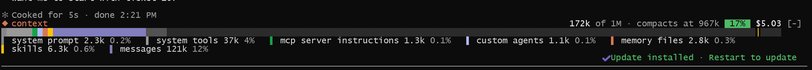

# context-bar

A Claude Code mod that draws your context window as a stacked bar above the prompt, one colour per `/context` category, so you can see usage without running `/context`.



```
◆ context  212k of 1M · compacts at 950k  21%  · 5h 5% ↻ 19:39 · week 37% ↻ Sat 14:59 $0.92
████▉███████████████░░░░░░░░░░░░░░░░░░░░░░░░░░░░░│░░▒▒▒
▌ system prompt 3.4k 0.3%   ▌ messages 186k 19%   ▌ skills 2.2k 0.2%
```

- Coloured runs: the categories using the window, in `/context`'s theme colours
- `░` free space, `▒` autocompact buffer, `│` where auto-compaction kicks in
- The percentage turns yellow at 50% and red at 80%
- `5h` and `week`: how much of your plan's current 5-hour session and weekly limit you have used, the same two figures `/usage` shows, each followed by `↻` and the local time it resets (the weekly one with its day). Each percentage turns yellow at 50% and red at 80%. They only appear on a Claude subscription, after the first response of the session reports them
- A dim stats row under the bar, each item shown only when it has something to say:
  - a sparkline of context size per turn, scaled to the compaction point
  - `+4.2k last turn`: how much the last turn added to the context
  - `738k to compact (~18 turns)`: room left before auto-compaction and, at the recent average growth, roughly how many turns that is (`to full` when auto-compaction is off)
  - `$0.12 last turn`: what the last turn cost
  - `cache 94%`: how much of the last request's input came from the prompt cache
  - the model, how long the session has run, how many times it has compacted and how many tool calls it has made
  - `messages 72% of used`, in yellow, when one category makes up 60% or more of the used context
- Pace for the `5h` and `week` limits: once 5% of a window has passed, usage is projected to its reset. If you're on course to hit the limit the percentage turns red even when it is still low, and a projection of 80% or more is shown as `→120%`
- The session's cost so far, as `/cost` totals it, at the far right. Claude Code only reports cost in US dollars, so it is always shown in `$`

It refreshes at session start, after each tool call, after each turn and after compaction, using the local `summary` estimate (no token-count API requests), so figures can differ slightly from `/context`.

## Install

In a Claude Code terminal session:

```
/plugin install context-bar --marketplace fredrikbonde/claude-context-bar
```

Answer `y` to add the marketplace, then pick the user scope. The bar shows straight away and in every session after.

Mods are an early-access Claude Code feature; this was built on Claude Code 2.1.294 and checked on 2.1.301.

## Use

`/context-bar` hides or shows the bar for the current session.

`/context-bar compact` switches to a short view, the header and the bar only, and back again.

The `[-]` at the right of the header is Claude Code's own control for hiding the bar; the plugin doesn't draw it.

## Update

```
claude plugin update context-bar
```

then `/reload-plugins` in a running session.

## Develop

```
claude plugin validate .
claude plugin test .
```
